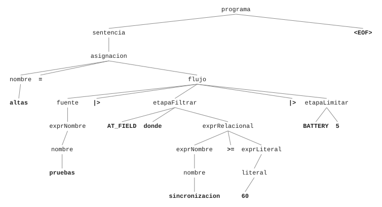

# EvangelionPL

- Julian Beltran
- Juan Orjuela
- Santiago Ortegon

Un lenguaje de dominio específico para analizar datos, con vocabulario de
*Neon Genesis Evangelion*. Proyecto del curso **Lenguajes de Programación y
Transducción** (Universidad Sergio Arboleda, 2026-2), hecho con ANTLR4 y Python.
El manejo de las tablas no usa pandas ni ninguna otra librería: lo hace una
librería propia que está en `src/evangelion/tablas.py`.

Los datos entran por el `ENTRY_PLUG`, el `AT_FIELD` solo deja pasar las filas
que cumplen una condición y las `MAGI` hacen los cálculos. Si el programa corre,
el EVA-01 te felicita. Si no, aparece Gendo.

```
NERV "Resumen por piloto"

pruebas = ENTRY_PLUG "datos/pruebas_sincronizacion.csv"

por_piloto = pruebas
    |> EJECT faltantes [sincronizacion]
    |> AT_FIELD donde sincronizacion >= 40
    |> SQUAD por [piloto]
    |> MAGI pruebas = contar(), promedio = media(sincronizacion)
    |> FORMATION por [promedio desc]

MONITOR por_piloto
SEELE por_piloto como "salidas/resumen.csv"
```

## Qué está hecho

| Fase | Qué incluye | Estado |
|---|---|---|
| 1 | Gramática, lexer y parser, árbol de análisis, errores léxicos y sintácticos | Lista |
| 2 | Visitor, tabla de símbolos, ejecución sobre datos con la librería propia, agregaciones, exportar CSV, errores semánticos | Lista |
| 3 | Gráficas y caso de estudio final | Pendiente (`HOLOGRAM` ya se reconoce, pero no dibuja) |

El manual completo, con la tabla de tokens, la gramática en EBNF y las reglas
semánticas, está en [`docs/manual_evangelionPL.pdf`](docs/manual_evangelionPL.pdf).

## Instalación

Hace falta Python 3.11 o superior. En Windows basta con:

```
instalar.bat
```

Eso crea el entorno virtual, instala las dependencias y corre las pruebas. A mano
sería:

```
python -m venv .venv
.venv\Scripts\activate
pip install -r requirements.txt
```

No se necesita Java para usar el lenguaje: el lexer y el parser ya vienen
generados en `src/evangelion/generado/`.

## Cómo se usa

Desde la carpeta del proyecto:

```
eva ejemplos\01_primera_prueba.eva
```

o, que es lo mismo, `python run.py ejemplos/01_primera_prueba.eva`.

| Opción | Qué muestra |
|---|---|
| `--tokens` | Los tokens que entrega el lexer |
| `--arbol` | El árbol de análisis en texto |
| `--svg arbol.svg` | El árbol como dibujo (se abre en el navegador) |
| `--simbolos` | La tabla de símbolos al terminar |
| `--solo-analisis` | Revisa el programa sin ejecutarlo |

### Cuando todo sale bien

```
MONITOR mejores (5 filas x 4 columnas)
fecha       piloto  unidad  sincronizacion
2015-10-19  Shinji  EVA-01           93.50
2015-07-20  Asuka   EVA-02           92.70
2015-08-03  Asuka   EVA-02           86.60
2015-10-05  Shinji  EVA-01           80.10
2015-09-07  Rei     EVA-00           77.90

                    /\
                   /  \
                  / /\ \
                 / /  \ \
          ______/ /____\ \______
         /                      \
        /   _____        _____   \
       |    \####\      /####/    |
       |     '----'    '----'     |
        \                        /
         \      .--------.      /
          \     |VVVVVVVV|     /
           \    |^^^^^^^^|    /
            '.  '--------'  .'
              '-.________.-'
                  EVA - 01

  ¡Felicidades, Shinji! (omedetou!)
  Sincronización con el EVA-01 al 100 %: 01_primera_prueba.eva corrió sin errores.

    Operación : Primera prueba de sincronizacion
    Tokens    : 42
    Variables : pruebas, mejores
```

### Cuando algo falla

```
                .-''''''''''''-.
              .'  ////////////  '.
             /   //////////////   \
            |    .____.  .____.    |
            |  --|####|--|####|--  |
            |    '----'  '----'    |
             \       .----.       /
              \   .-'|_||_|'-.   /
          _____'-/  /|_||_|\  \-'_____
         /      /  / |_||_| \  \      \
        /      /  /   '--'   \  \      \
       /      /  /            \  \      \
      /      /__/              \__\      \
  ___/____________________________________\___

  ALERTA: sincronización fallida.
  Nivel de contaminación mental alto, el EVA no arranca.

  Error semántico en sem_02_columna_inexistente.eva, línea 3, columna 35
    'sincronisacion' no es una columna de la tabla ni una variable. ¿Quisiste decir 'sincronizacion'?
        3 | altas = pruebas |> AT_FIELD donde sincronisacion > 60
          |                                   ^

  Gendo: "Corrige la línea 3, Shinji. O vete."
```

Los errores pueden ser léxicos (un carácter que no existe), sintácticos (algo mal
escrito) o semánticos (bien escrito pero sin sentido, como promediar nombres).
Siempre dicen la línea y la columna.

## Instrucciones

| Instrucción | Qué hace |
|---|---|
| `NERV "título"` | Nombre de la operación (opcional, primera línea) |
| `ENTRY_PLUG "archivo.csv"` | Carga un CSV. Acepta `con { separador: ";" }` |
| `TARGET [a, b]` | Deja solo esas columnas |
| `AT_FIELD donde condición` | Filtra filas |
| `SYNC col = expresión` | Crea columnas calculadas |
| `CODENAME [vieja -> nueva]` | Renombra columnas |
| `FORMATION por [col desc]` | Ordena |
| `EJECT duplicados \| faltantes \| columnas` | Elimina filas repetidas, filas con vacíos o columnas |
| `DUMMY_PLUG col = valor` | Rellena vacíos |
| `EQUIP col -> tipo` | Convierte a entero, real, texto o booleano |
| `SQUAD por [a, b]` | Agrupa (después va `MAGI`) |
| `MAGI n = contar(), m = media(col)` | Resume: suma, media, mediana, minimo, maximo, desviacion, contar |
| `BATTERY n` | Primeras n filas |
| `DIAGNOSTIC` | Estadísticas de cada columna |
| `MONITOR flujo` | Muestra en pantalla |
| `SEELE flujo como "archivo.csv"` | Guarda en CSV |
| `PATTERN_BLUE cond { } PATTERN_ORANGE { }` | Condicional |
| `HOLOGRAM barras de tabla { }` | Gráfica (se revisa, todavía no se dibuja) |

Las etapas se encadenan con `|>` y ninguna cambia la tabla original: cada una
devuelve una tabla nueva. Los comentarios empiezan con `#`.

## Árbol de análisis

Para `altas = pruebas |> AT_FIELD donde sincronizacion >= 60 |> BATTERY 5`:



## Estructura

```
grammar/              Eva.g4 (reglas léxicas y sintácticas juntas)
src/evangelion/
    analizador.py     fase 1: tokens y árbol
    interprete.py     fase 2: Visitor que revisa y ejecuta el programa
    tablas.py         librería propia: tablas, columnas, estadísticas y CSV
    simbolos.py       tabla de símbolos
    errores.py        errores en español con línea y columna
    arbol.py          árbol en texto, paréntesis y SVG
    consola.py        el EVA-01 y Gendo
    cli.py            línea de comandos
    generado/         lo que genera ANTLR (no se edita)
ejemplos/             programas .eva válidos
ejemplos/errores/     programas que deben fallar (lex_, sin_, sem_)
datos/                CSV de práctica
tests/                pruebas con pytest
docs/                 manual en PDF, gramática EBNF y el script que arma el PDF
```

## Librería propia

Todo lo que se hace con los datos está escrito a mano en `tablas.py`:

- Leer y escribir CSV (con comillas, otros separadores y detección de números).
- `Columna`: operaciones fila por fila, comparaciones y manejo de faltantes.
- Estadísticas: suma, media, mediana, mínimo, máximo, desviación estándar y conteos.
- `Tabla`: seleccionar, filtrar, ordenar por varias columnas, quitar duplicados y
  faltantes, agrupar y resumir, y mostrarse alineada en la terminal.

Lo único que viene de afuera es el runtime de ANTLR4, que es la herramienta que
pide el curso, y pytest, que solo se usa para correr las pruebas.

## Pruebas

```
python -m pytest
```

Son 163 pruebas: tokens, precedencia, forma del árbol, cada etapa del flujo
comparada con el resultado esperado, los errores de las tres clases, la librería
de tablas por separado y los ejemplos completos de punta a punta.

## Cambiar la gramática

Si se edita `grammar/Eva.g4` hay que volver a generar el lexer y el parser. Para eso sí
hace falta Java 11 o superior:

```
python regenerar.py
```

El manual se vuelve a generar con `pip install pypdf` y
`python docs/generar_manual.py` (usa Chrome o Edge para imprimir el PDF).

## Sobre los datos

Los CSV de `datos/` son de práctica: los nombres salen de la serie y las cifras
son inventadas. El lenguaje carga cualquier CSV.

---
