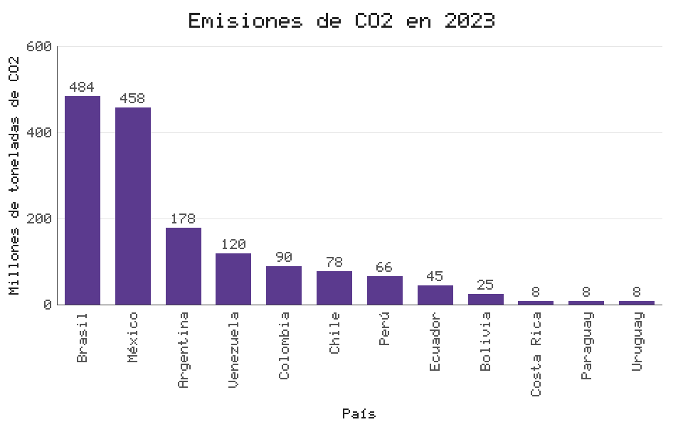
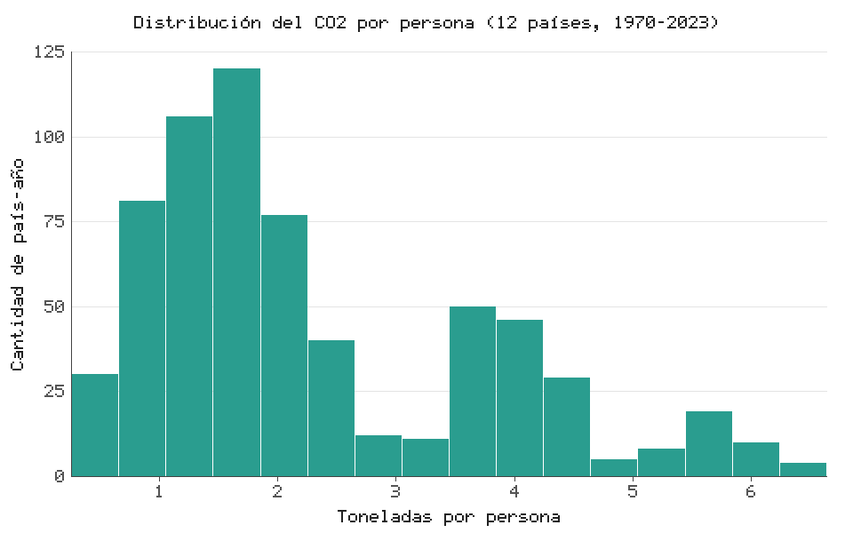
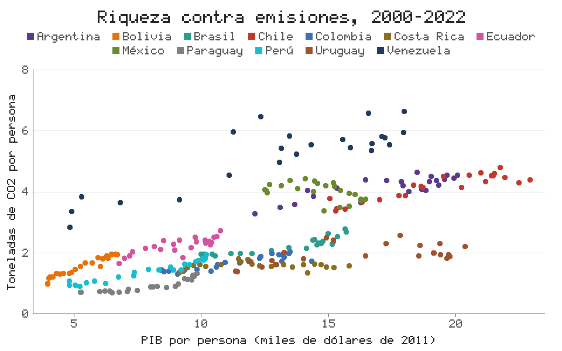
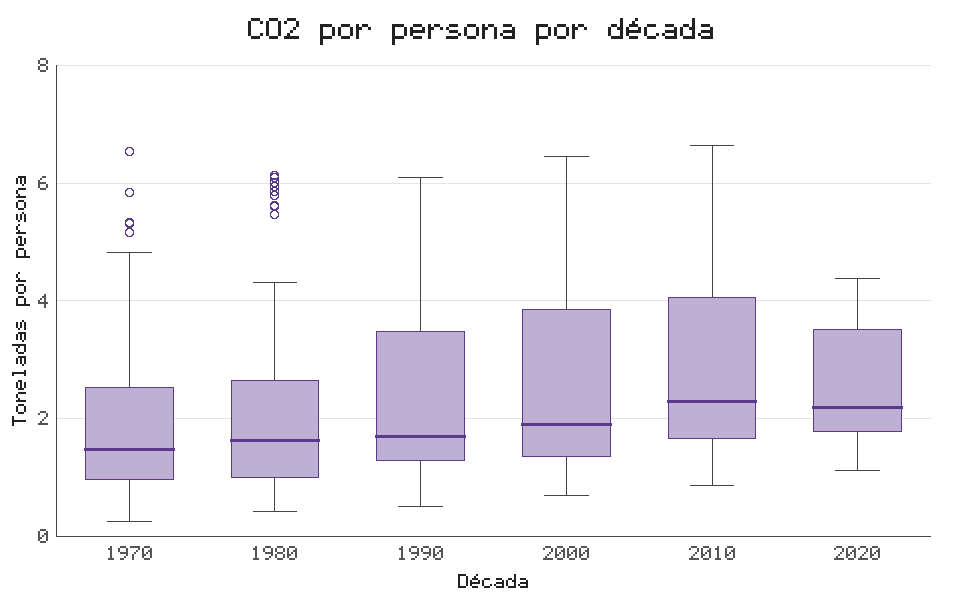

# Caso de estudio: emisiones de CO2 en América Latina, 1970-2023

Este es el caso de la fase 3. Un solo programa en evangelionPL
([`co2_latam.eva`](co2_latam.eva)) carga datos reales, los limpia, calcula
indicadores, exporta dos tablas y dibuja cinco gráficas, sin tocar el código
Python del intérprete.

```
eva caso_estudio\co2_latam.eva
```

## 1. Los datos

| | |
|---|---|
| Fuente | Our World in Data, *CO2 and Greenhouse Gas Emissions* ([github.com/owid/co2-data](https://github.com/owid/co2-data)), que a su vez toma el Global Carbon Budget y otras fuentes oficiales |
| Licencia | CC BY 4.0 (se puede usar citando la fuente) |
| Archivo | [`datos/co2_latam.csv`](../datos/co2_latam.csv), 648 filas y 13 columnas |
| Alcance | 12 países (Argentina, Bolivia, Brasil, Chile, Colombia, Costa Rica, Ecuador, México, Paraguay, Perú, Uruguay y Venezuela), años 1970 a 2023, una fila por país y año |
| Descargado | 20 de octubre de 2026 |

Las columnas vienen en inglés, tal como las publica la fuente:

| Columna | Qué es | Unidad |
|---|---|---|
| `country`, `year`, `iso_code` | País, año y código ISO | |
| `population` | Población | personas |
| `gdp` | PIB | dólares internacionales de 2011 |
| `co2` | Emisiones de CO2 por combustibles fósiles e industria | millones de toneladas |
| `co2_per_capita` | Lo mismo dividido por la población | toneladas por persona |
| `coal_co2`, `oil_co2`, `gas_co2`, `cement_co2` | CO2 por carbón, petróleo, gas y cemento | millones de toneladas |
| `energy_per_capita` | Consumo de energía primaria por persona | kWh |
| `share_global_co2` | Parte del CO2 mundial | % |

El archivo completo de la fuente pesa 14 MB. [`descargar_datos.py`](descargar_datos.py)
lo baja otra vez y solo recorta filas y columnas: el renombrado, la limpieza
y todos los cálculos los hace el programa en evangelionPL.

**Faltantes:** `gdp` no tiene 2023 (12 filas), `coal_co2` y `gas_co2` faltan
en 145 y 136 filas y `energy_per_capita` en 40. Las columnas de CO2 total y per
cápita están completas.

## 2. Preguntas

1. ¿Qué países emitieron más CO2 en 2023?
2. ¿Cómo cambió el CO2 por persona de los seis países que más emiten?
3. ¿Cómo se reparten los valores de CO2 por persona entre todos los países y años?
4. ¿Los países con más PIB por persona emiten más por persona?
5. ¿La diferencia entre países creció o se achicó de una década a otra?
6. ¿Colombia está por encima o por debajo del promedio de la región?

## 3. Limpieza y transformación

Todo pasa en la primera sentencia del programa:

| Paso | Instrucción |
|---|---|
| Nombres de columna en español | `CODENAME [country -> pais, year -> año, ...]` |
| Quitar la columna que no se usa | `EJECT columnas [iso_code]` |
| Quitar filas sin el dato principal | `EJECT faltantes [co2_mt, co2_pc]` |
| Evitar países repetidos en un mismo año | `EJECT duplicados [pais, año]` |
| Nombres de país en español | `SYNC pais = reemplazar(pais, "Brazil", "Brasil")`, y lo mismo con México y Perú |
| Columnas nuevas | `decada = año - año % 10` y `pib_pc = redondear(pib / poblacion, 0)` |

Después, `DIAGNOSTIC` imprime cuántos datos válidos y faltantes tiene cada columna.

## 4. Indicadores

| Archivo | Qué trae |
|---|---|
| [`resultados/emisiones_2023.csv`](resultados/emisiones_2023.csv) | CO2 total, per cápita y parte del mundo de cada país en 2023, de mayor a menor |
| [`resultados/resumen_por_pais.csv`](resultados/resumen_por_pais.csv) | Por país: años con datos, media, máximo y desviación del CO2 per cápita en 1970-2023 |

Además, el programa calcula el CO2 por persona de Colombia en 2023 (1,72 t) y
el promedio simple de los 12 países (2,59 t), y con `PATTERN_BLUE` imprime cuál
de los dos es mayor.

## 5. Gráficas

| | Tipo | Archivo |
|---|---|---|
| G1 | Barras | [`g1_barras_emisiones_2023.png`](resultados/g1_barras_emisiones_2023.png) |
| G2 | Líneas (una por país) | [`g2_lineas_co2_por_persona.png`](resultados/g2_lineas_co2_por_persona.png), y también en [SVG](resultados/g2_lineas_co2_por_persona.svg) |
| G3 | Histograma | [`g3_histograma_co2_por_persona.png`](resultados/g3_histograma_co2_por_persona.png) |
| G4 | Dispersión (un color por país) | [`g4_dispersion_pib_vs_co2.png`](resultados/g4_dispersion_pib_vs_co2.png) |
| G5 | Caja (una por década) | [`g5_caja_por_decada.png`](resultados/g5_caja_por_decada.png) |







## 6. Qué muestran los resultados

1. **Pocos países concentran casi todo.** En 2023 Brasil (484 Mt) y México
   (458 Mt) emitieron el 60 % del CO2 de los 12 países. Juntos, los 12 países
   sumaron 1.567 Mt, el 4,1 % del CO2 mundial. Colombia quedó quinta con 90 Mt
   (0,24 % del mundo).
2. **Emitir mucho en total no es lo mismo que emitir mucho por persona.** Brasil
   es el que más emite, pero por persona (2,29 t) queda por debajo de Venezuela
   (4,23 t), Chile (3,95 t), Argentina (3,92 t) y México (3,53 t). Toda la
   región está por debajo del promedio mundial, que en 2023 fue de 4,71 t por
   persona según la misma fuente.
3. **Colombia cambió poco.** Pasó de 1,36 t por persona en 1970 a 1,72 t en
   2023. De los 12 países es el de la serie más estable (desviación de 0,18 t),
   y en 2023 estuvo por debajo del promedio regional (2,59 t).
4. **Venezuela es el caso aparte.** Fue la que más emitió por persona durante
   casi todo el periodo, con un pico de 6,63 t en 2013, y cayó a 2,84 t en 2020,
   en medio de la crisis económica del país. Chile hizo el camino contrario: de
   2,5 t en 1970 a más de 4,5 t en la década de 2010.
5. **La distribución tiene dos grupos.** El histograma muestra un grupo grande
   entre 1 y 2,5 t (los países de emisiones bajas) y otro entre 3,5 y 4,5 t
   (Argentina, México, Chile y, en los últimos años, Venezuela), más una cola
   arriba de 5 t que es casi toda de Venezuela.
6. **Más PIB por persona, más CO2 por persona.** En 2000-2022 la relación es
   clara en la dispersión. La correlación de Pearson da 0,66 con todos los
   países y 0,75 sin Venezuela (calculada aparte, fuera del lenguaje). Uruguay y
   Costa Rica son la excepción: tienen PIB per cápita alto y emiten poco, lo que
   cuadra con que buena parte de su electricidad es renovable (dato de contexto
   que no está en este archivo).
7. **Las diferencias crecieron y después se cerraron un poco.** La mediana
   regional subió de 1,48 t en los años 70 a 2,19 t en los 2020. La caja de cada
   década se fue ensanchando hasta 2010, y en los 2020 se angostó porque los
   países que más emitían bajaron y los que menos emitían subieron.

**Límites del análisis.** Son solo emisiones por combustibles fósiles e
industria (no incluyen deforestación, que en Brasil y Bolivia pesa mucho). El
promedio regional es simple, no ponderado por población. Y una correlación no
dice qué causa qué.

## 7. Cómo reproducirlo

Desde la carpeta del proyecto, con el entorno instalado (`instalar.bat`):

```
python caso_estudio/descargar_datos.py    # opcional: baja la versión más nueva de los datos
eva caso_estudio\co2_latam.eva           # escribe todo en caso_estudio/resultados/
```

El programa corre en menos de un segundo. La prueba
`test_el_caso_de_estudio_corre_y_deja_todo` (en `tests/test_fase3.py`) lo corre
completo en una carpeta temporal y revisa que salgan las tablas y los cinco PNG.
